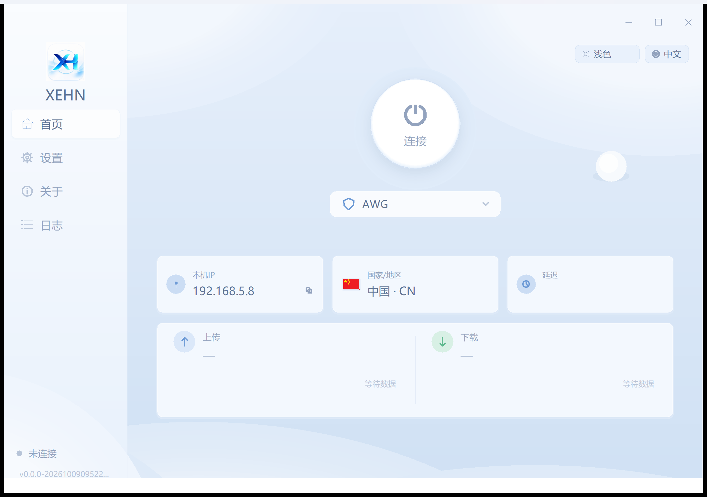
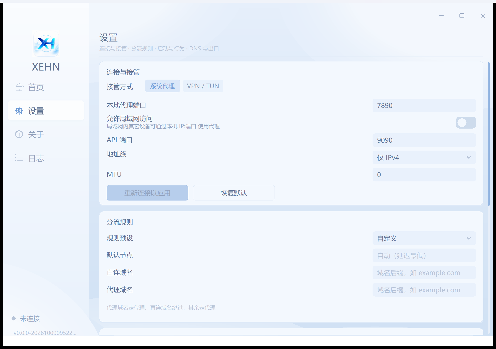
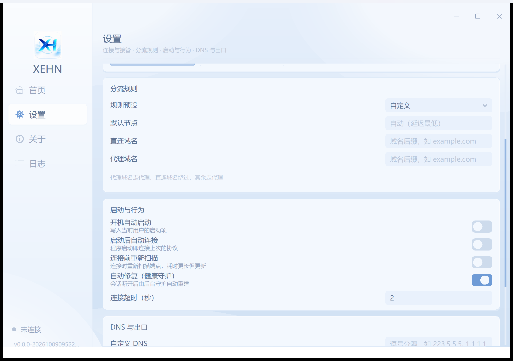
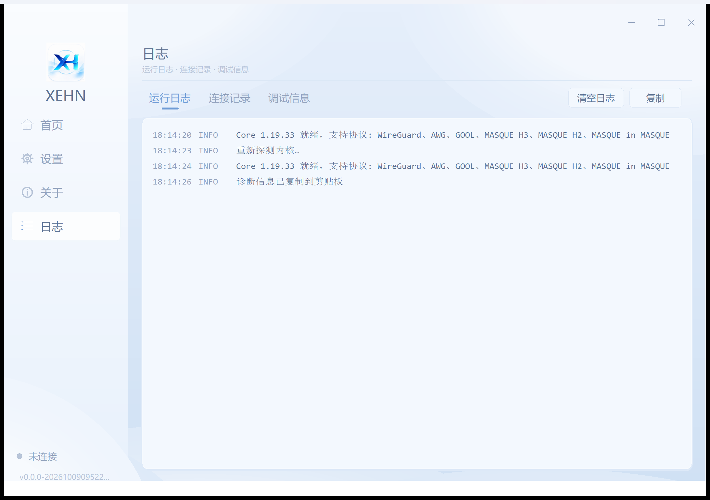
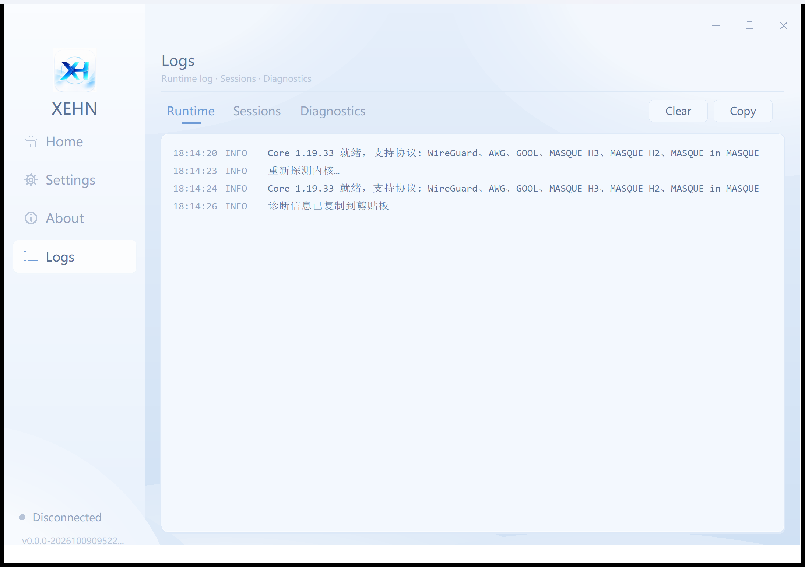

# XEHN

A Windows client for Cloudflare WARP that scans for the best endpoint and
connects through it in one click — built on top of
[`vernette/warpscout`](https://github.com/vernette/warpscout)'s scanning engine
with an embedded Clash (mihomo) core for actual traffic routing.

**Download:** [latest release](https://github.com/hezhanleiok/xehn/releases/latest)
— unzip the portable package anywhere writable and double-click
`xehn.exe`. The package carries no account: the first connect registers
a fresh WARP device for that machine.

## What it does

| capability                          | status |
|-------------------------------------|--------|
| WARP endpoint scan (2-phase probe + tunnel verify) | ✅ reused from warpscout |
| Account register / rotate           | ✅ reused from warpscout |
| AmneziaWG (AWG) core                 | ✅ `amneziawg-go` userspace (scan) + mihomo `amnezia-wg-option` (routing) |
| WireGuard                           | ✅ mihomo `type: wireguard` |
| MASQUE / MASQUE-H2                  | ✅ mihomo `type: masque` + `network: h2` |
| WARP-in-WARP (nested)               | ✅ mihomo `dialer-proxy` chains |
| Psiphon exit (V1, base + Psiphon)   | ✅ `psiphon.exe` sidecar over a localhost SOCKS; `connect --psiphon` |
| Exit IP / latency / country display | ✅ live probe via mixed-port + cached scan meta |
| Scan-result + account cache (TTL)   | ✅ `internal/cache` (6h TTL, JSON, survives reload) |
| System-proxy mode (default)         | ✅ WinINET registry + `InternetSetOption` notify |
| TUN global mode (optional)          | ✅ mihomo `tun:` block (needs admin; wintun is embedded) |
| Native GUI (double-click portable)    | ✅ sidebar shell — Home/Settings/About/Logs, light+dark theme, 中文/English |
| Licence notice + remote control       | ✅ startup notice; per-install control code checked against `control.json` |
| Portable ZIP, core separated        | ✅ `pack.ps1` → v2rayN-style layout |
| Core one-click download/update      | ✅ GitHub releases auto-provision |

## Quick start (portable, v2rayN style)

```powershell
# 1. unzip anywhere writable
# 2. double-click xehn.exe  →  native window opens (Proton style)
# 3. click 连接 — first run auto-registers a WARP account + scans
```

ZIP layout (`pack.ps1` assembles it):

```
XEHN\
├── xehn.exe             ← the only program file: double-click opens the GUI;
│                           arguments run the CLI in the calling terminal
├── core\
│   ├── mihomo.exe        ← the Clash core — replace this file to update it
│   ├── psiphon.exe       ← optional: Psiphon exit sidecar (GPL-3.0)
│   ├── client.config     ← optional: official Psiphon credentials (needed with psiphon.exe)
│   └── server_list.dat   ← optional: initial Psiphon server list
└── README.txt
```

The ZIP is assembled from a fresh staging tree and never contains
`warpscout-account.json`, state, settings, caches or logs: a new device has no
credentials, so its first connect/scan registers a new WARP account there. Do
not copy an old `warpscout-account.json` along with the program unless you
intend to reuse that device identity.

The executable auto-anchors `WARP_CLIENT_HOME` to its own folder (portable
mode), so account, cache, state, config and logs all stay next to the exe —
delete the folder and everything is gone.

### Updating the core later (核心分离)

The GUI never embeds mihomo; it manages `core\mihomo.exe` as a plain file:

- **One click**: dashboard → 「更新核心」 downloads the latest
  `mihomo-windows-amd64` release.
- **Manual**: drop any mihomo build into `core\mihomo.exe` — no rebuild, no
  version lock. `xehn.exe` also accepts `-core PATH` to point elsewhere.

### The GUI

`xehn.exe gui` (or a bare double-click) opens a
**native Windows window** — self-drawn on [`lxn/walk`](https://github.com/lxn/walk)
(a single `CustomWidgetPixels` canvas; no browser, no webview, no runtime UI
dependency). The layout is a 1080x700 grid scaled by the display DPI, so it
stays sharp from 100% to 250% Windows scaling.

A left rail switches between four pages, and the header carries the two
appearance switches (theme, language) so neither needs a trip to settings:

| page | contents |
|---|---|
| **Home** | connect/disconnect circle with the session clock, current exit (flag, colo, latency, up/down), protocol selector with live core-capability state, selected node detail + live throughput chart |
| **Settings** | one page, four cards: capture (system proxy or VPN/TUN, local proxy port, LAN access, API port, address family with protocol gating, MTU), routing (proxy mode, default node, split tunnelling, domain lists, geo split), startup/behaviour (autostart, auto-connect, rescan, auto-repair, remember page, timeout), DNS & exit (presets, no-DNS, Psiphon + region) |
| **About** | versions, data/core paths, licences, client and core updates |
| **Logs** | run log (level-tagged console), connection history (the connect pipeline's own steps), diagnostics (copyable) |

Theme: **light (default)**, dark, or follow the system — switched live, title
bar included. Language: **中文 (default)** or English; every string goes through
one table, so a missing translation falls back to Chinese instead of showing a
key.

#### Screenshots

**Home** — the connect circle with the session clock, the live exit (flag,
colo, latency, throughput) and the protocol picker:



**Settings** — one scrollable page: capture (system proxy or VPN/TUN, local
port, LAN access, API port, address family, MTU) and routing (preset, default
node, direct/proxy domain lists):



…then startup/behaviour (autostart, auto-connect, rescan, auto-repair,
timeout) and DNS & exit:



**Logs** — runtime log, connection history and copyable diagnostics:



The About page follows the same grid — this build, its licences, updates, the
remote-control code, and one card of GitHub links — and is described in
[Licence notice and remote control](#licence-notice-and-remote-control) below.

The same window in English (the language pill lives in the Home header, so it
never needs a trip to settings):



Preferences live in `settings.json` next to the exe (portable layout) and are
applied to the engine on connect: proxy mode and the domain lists become mihomo
rules, per-app split becomes `PROCESS-NAME` rules, and DNS / MTU / address
family go into the rendered config. The region split is offered only when the
core's `geosite.dat` / `geoip.metadb` are already present — mihomo tries to
download them as soon as a `GEOSITE` rule appears and refuses the whole config
when it cannot, so the switch stays off rather than producing a config that
cannot start.

The GUI runs the exact same code path as the CLI
(`defaultConnectOptions` → `runConnectCmd`), so behaviour cannot drift.

### Licence notice and remote control

Every launch opens with the licence reminder this project asks its builds to
carry — **本软件开源免费，仅供学习交流使用，禁止售卖！** — and the same
sentence stays at the foot of the About page, so it is still there after the
notice has been dismissed. The About page itself points at nothing local: every
row and button opens a GitHub address (project page, releases, issues, notices,
licence text, core source), because a path on this disk is useless to anyone
reading the page on another machine.

Each install also carries a **control code** (`XXXX-XXXX-XXXX-XXXX`, shown and
copyable on About), derived from the machine's Windows identity — so deleting
`settings.json` does not mint a fresh one. The client reads
[`control.json`](control.json) from the default branch at startup and every 15
minutes:

```json
{
  "stop_all": false,
  "stopped_codes": ["ABCD-EFGH-JKMN-PQRS"],
  "message": ""
}
```

A listed code — or `stop_all` — stops that client: it refuses to connect, tears
down a session that is already up, and says why on screen. `message` replaces
the default sentence. The check is deliberately **fail-open**: an unreachable
list keeps the previous verdict, so an offline laptop or a blocked GitHub never
bricks a legitimate install, while the verdict is cached in `control-state.json`
so a restart cannot quietly put a stopped client back into service.

## Architecture

```
xehn (package main)            the warpscout engine (verbatim) +
                                     the client orchestration layer
├── cli.go / flags.go                command registry + flag wiring
├── main.go                          scan command (warpscout)
├── register.go                      account registration (warpscout)
├── tunnel.go / masque.go / nest.go  userspace tunnels: AWG/MASQUE/WARP-in-WARP
├── wgconf.go                        native .conf + mihomo proxy rendering
├── client.go          ★             full mihomo config renderer + cache glue
├── connect.go         ★             connect/disconnect/status/list commands
├── gui.go             ★             GUI/CLI shared entry (defaultConnectOptions)
├── gui_dispatch.go    ★             `gui` command + double-click entry
├── gui_native_windows.go ★          window, model, paint dispatch, background loops
├── gui_theme_windows.go ★           light/dark palettes, theme resolve, dark title bar
├── gui_i18n_windows.go ★            中文/English string table (tr/trf)
├── gui_draw_windows.go ★            canvas primitives + widgets (cards, chips, switches)
├── gui_shell_windows.go ★           sidebar + page header + page routing
├── gui_page_home_windows.go ★       Home page
├── gui_page_nodes_windows.go ★      Nodes page (not in the sidebar; node choice is the Settings pin)
├── gui_page_settings_windows.go ★   Settings page (capture / routing / startup / DNS & exit)
├── gui_page_logs_windows.go ★       Logs page (run / history / diagnostics)
├── gui_actions_windows.go ★         id → action routing, settings actions
├── gui_dialogs_windows.go ★         modal input/confirm, autostart, prefs plumbing
├── gui_native_stub.go ★             non-Windows no-op (native window = disabled)
├── settings.go        ★             settings.json model, load/save, normalisation
├── control.go         ★             per-install control code + remote stop list
├── control.json       ★             the published stop list the client reads
│
├── internal/cache     ★             TTL cache store (account + scan results)
└── internal/core      ★             mihomo sidecar manager + system proxy
    ├── core.go                      process lifecycle, config write, readiness
    ├── download.go                  locate/download mihomo core binary
    ├── proxy_windows.go             WinINET system proxy set/unset
    └── proxy_other.go               non-Windows no-op stub
```

`★` = new code added on top of the warpscout engine.

## The two "cores" the client introduces

1. **AWG core** — `amneziawg-go` (already a warpscout dependency). It is the
   userspace AmneziaWG implementation used both for *scanning* (the tunnel that
   verifies an endpoint really exits where it claims) and as the basis the
   mihomo proxy renders into.
2. **Clash core** — mihomo (MetaCubeX/mihomo), run as a **sidecar binary**. This
   is the same pattern every mature Clash GUI (Clash Verge, FlClash, …) uses:
   the client writes a full `config.yaml`, spawns the core, controls it over
   the `external-controller` REST API, and points the OS at its mixed port.
   mihomo natively speaks `wireguard` (+ `amnezia-wg-option`), `masque`
   (+ `network: h2`) and `dialer-proxy` chains, so a single embedded core
   covers all four protocols + WARP-in-WARP for routing.

## Build

Requires Go 1.26+ (module targets 1.26.3). On networks where
`proxy.golang.org` is unreachable, point Go at a mirror:

```powershell
$env:GOMODCACHE='E:\xiaohe\xhwarp\.gomod'
$env:GOCACHE='E:\xiaohe\xhwarp\.gocache'
$env:GOPATH='E:\xiaohe\xhwarp\.gopath'
$env:GOPROXY='https://goproxy.cn,direct'

# one program file: double-click opens the GUI, arguments run the CLI
go build -trimpath -ldflags "-s -w -H windowsgui -X main.version=1.0 -X main.windowsGUIBuild=1" -o xehn.exe .

# everything above + the portable ZIP in dist\ (the supported release path):
powershell -ExecutionPolicy Bypass -File .\pack.ps1 [-MihomoPath <mihomo.exe>] [-PsiphonExePath <psiphon.exe>] [-PsiphonConfigPath <client.config>]
```

The native window links a Win32 manifest (comctl32 v6) embedded into
`rsrc_windows_amd64.syso` — without it `lxn/walk` fails at startup with
`TTM_ADDTOOL failed`. `pack.ps1` regenerates the `.syso` from `app.manifest`
using `akavel/rsrc` (install once with `go install github.com/akavel/rsrc@latest`).

`-H windowsgui` strips the console subsystem flag, so a double-click never
flashes a terminal window. The same binary still serves the CLI: with a
subcommand it attaches to the caller's console and reopens its standard
streams. With no console attached the GUI redirects all output (its own and the
mihomo core's) to `xehn.log` next to the exe. Because Windows does not
wait for a GUI-subsystem process, `cmd` returns to its prompt immediately while
register/connect keep running in the background; their output stays attached to
that terminal.

## Usage

```powershell
# 0. no arguments at all → the native GUI window (double-click equivalent)
xehn.exe
xehn.exe gui      # force the native window

# 1. register a WARP account
xehn register

# 2. connect — scans (cached 6h), picks best endpoint, starts core, sets proxy
xehn connect -p awg
xehn connect -p wg
xehn connect -p masque
xehn connect -p masque-h2
xehn connect --tun            # TUN global mode (needs admin)
xehn connect --scan-now       # force re-scan, ignore cache
xehn connect -p awg --psiphon # base protocol + Psiphon exit (final IP = Psiphon)

# 3. show current exit IP / latency / country
xehn status

# 4. list cached endpoints
xehn list
xehn list -p wg

# 5. disconnect — stops core, restores prior system-proxy state
xehn disconnect

# raw engine commands (from warpscout) still work:
xehn scan -best -p awg
xehn scan -conf - -conf-type mihomo -p awg
```

### Portable / custom home

When `WARP_CLIENT_HOME` is unset, the client auto-anchors its home to the
executable's folder (if writable — e.g. the extracted ZIP) and falls back to
`%APPDATA%\xehn` otherwise. Set the variable explicitly to pin it:

```powershell
$env:WARP_CLIENT_HOME='D:\warp-portable'
xehn connect
```

### Psiphon exit (V1)

Psiphon is an **exit**, not a fifth protocol. `connect --psiphon` brings the base
protocol (WG / AWG / MASQUE) up first, points Psiphon's upstream at that localhost
SOCKS, and makes Psiphon the final egress — so the public exit IP becomes
Psiphon's. The session is a composition: `status` shows e.g. `session=AWG-Psiphon`,
while `state.Proto` stays the base protocol (`awg`) and the switch lives in
`psiphon_mode`.

Assets — both required; `connect --psiphon` fails fast with a clear message if
either is missing:

| asset | default location | override |
|---|---|---|
| Psiphon executable | `core\psiphon.exe` | `--psiphon-exe` flag, else `PSIPHON_EXE` env |
| official client config | `core\client.config`, then `core\psiphon.config` | `PSIPHON_CONFIG` env |

The client config carries the `SponsorId` / `PropagationChannelId` /
`RemoteServerListURLs` / `ObfuscatedServerListRootURLs` and their signature keys
— without it Psiphon discovers zero servers and never builds a tunnel. A
`server_list.dat` next to it is used as the initial server list.

```powershell
xehn connect -p awg --psiphon
xehn status            # session=AWG-Psiphon  endpoint=…  exit=<Psiphon exit IP>
```

`psiphon-tunnel-core` is **GPL-3.0**. It ships as a separate `psiphon.exe`
process driven over a localhost SOCKS and is never linked into this binary.
`pack.ps1` bundles `psiphon.exe` / `client.config` / `server_list.dat` into
`core\` when present (or when passed via `-PsiphonExePath` /
`-PsiphonConfigPath`).

Because the ZIP ships GPL-3.0 binaries (mihomo too), the pack also carries the
license text and the obligations inventory: see
[`THIRD_PARTY_NOTICES.md`](THIRD_PARTY_NOTICES.md) and
`licenses/GPL-3.0.txt` in the ZIP. **Legal review is required before public
distribution** — that file is an engineering inventory, not a legal conclusion.

### TUN mode

`--tun` adds a `tun:` block to the mihomo config and routes all traffic through
a virtual interface instead of the system proxy. Requirements:

- Run the client as **administrator** (elevated). The mihomo build this client
  ships embeds wintun, so no extra `wintun.dll` is required.

## Tests

```powershell
go test ./...          # hermetic suite

# + real-core integration test (renders configs for all 4 protocols, boots a
#   real mihomo, asserts controller + proxy registration + mixed-port):
$env:WARP_TEST_MIHOMO='path\to\mihomo.exe'
go test -v -run TestMihomoAcceptsRenderedConfig .
```

`internal/cache` — put/get round-trip, TTL expiry, reload survival, corrupt-file
recovery. `internal/core` — config validation, atomic write, readiness timeout.
`package main` — cached-scan round-trip, state persistence, `list`/`status`
clean degradation, endpoint ranking tie-breaks, portable-home override, and
(with `WARP_TEST_MIHOMO`) the live core integration across `awg` / `wg` /
`masque` / `masque-h2`.
